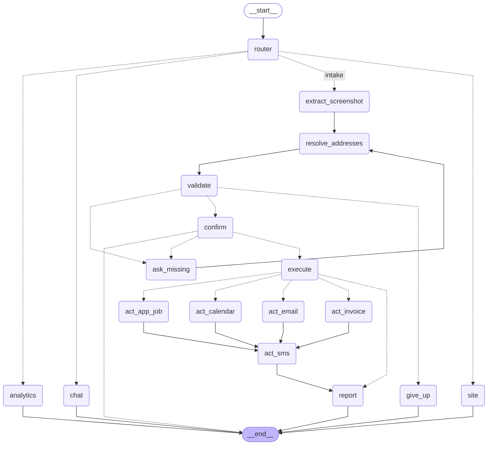

# Ops agent graph

Generated from `agent/graph.py` by `draw_graph.py`. Do not edit by hand.

- **Solid arrow**: always goes to the next step.
- **Dotted arrow**: a decision. The step picks one route (or several, for the
  parallel booking actions after `execute`).
- `ask_missing` and `confirm` pause and wait for a human reply before continuing.

